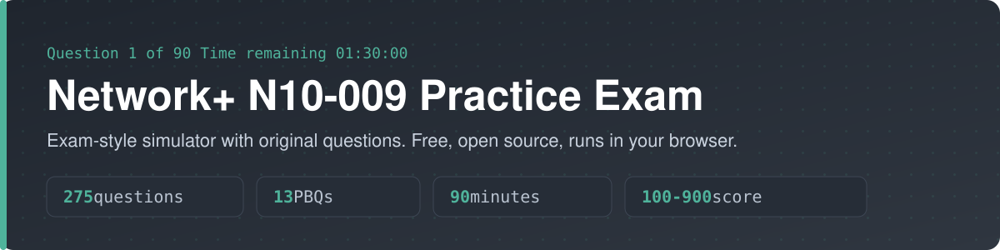
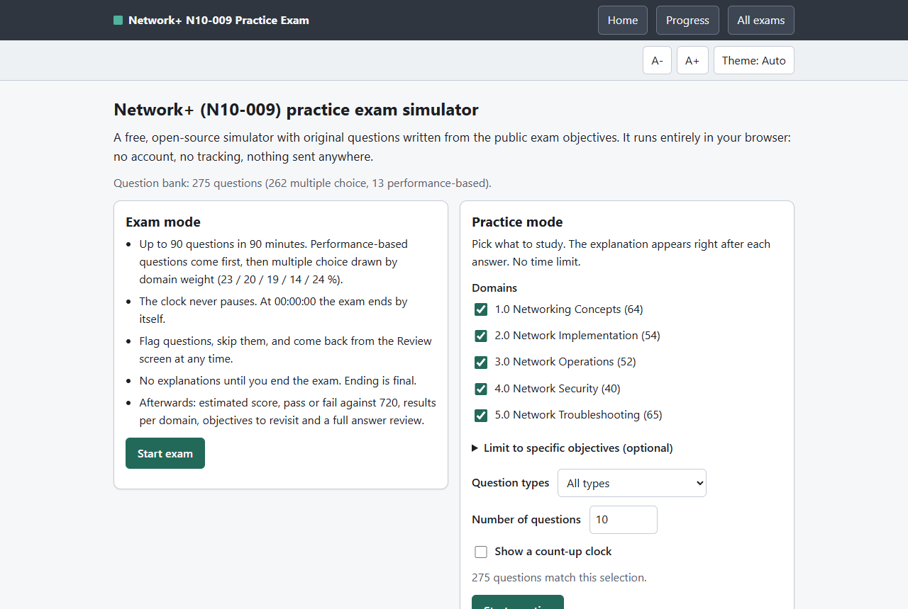
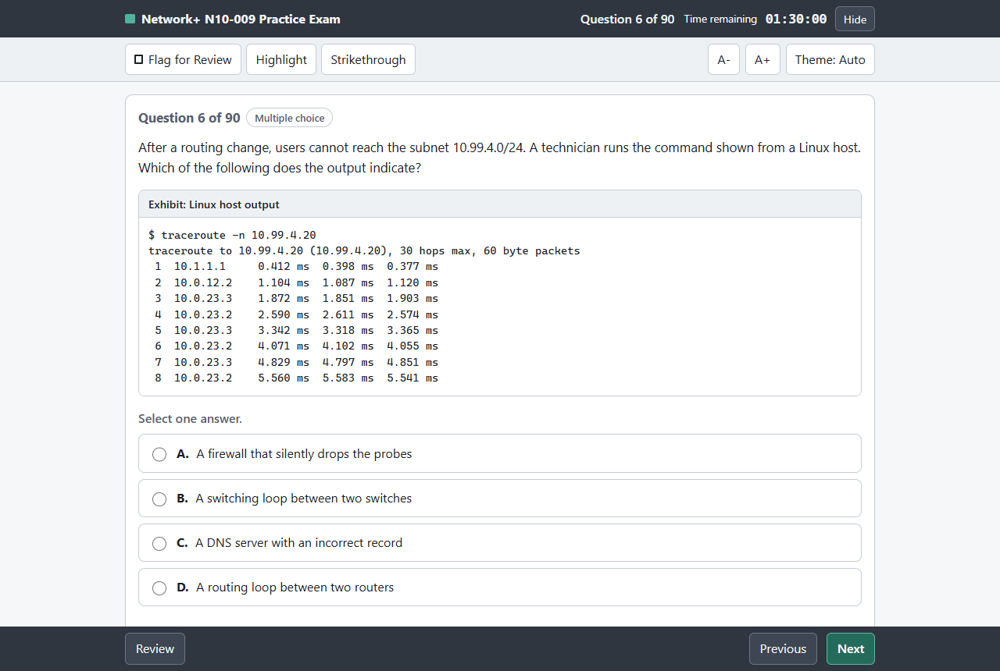
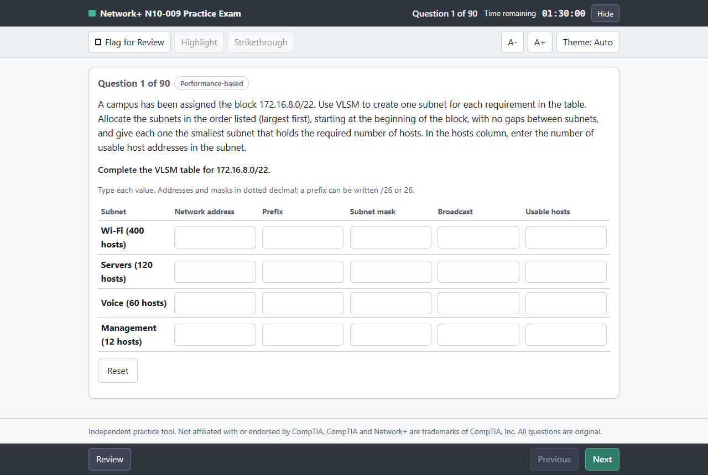
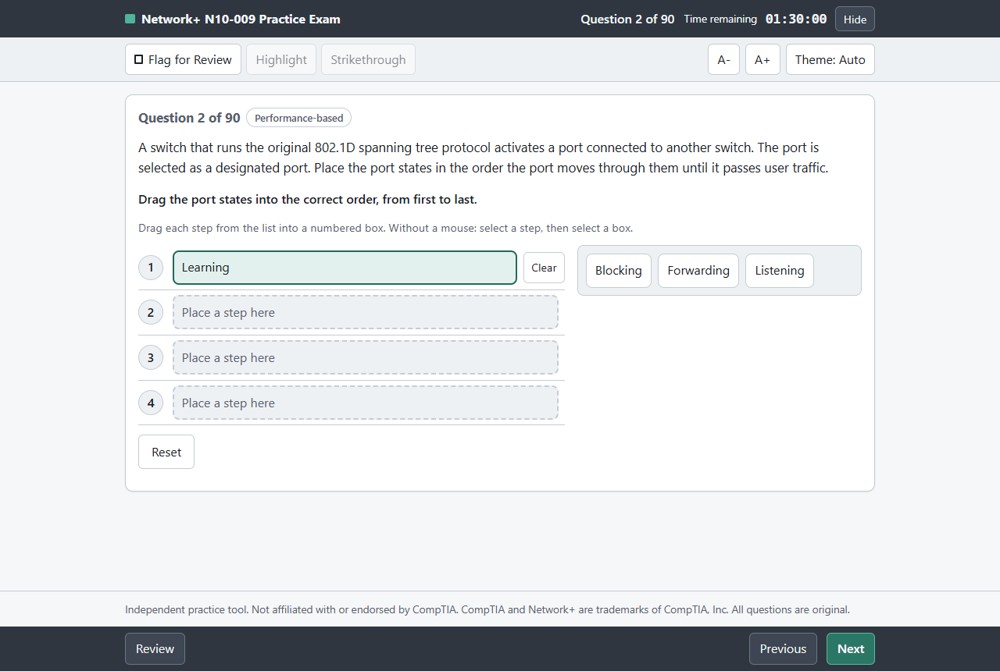

<p align="center">
  <a href="https://bazeeza.github.io/Comptia-Exam-Practice/Network+-Exam-Practice/">
    
  </a>
</p>

<h3 align="center">
  <a href="https://bazeeza.github.io/Comptia-Exam-Practice/Network+-Exam-Practice/">Start practicing now</a>
</h3>

<p align="center">
  Free. No account. Nothing to install. Works on a phone.<br>
  <a href="https://bazeeza.github.io/Comptia-Exam-Practice/Network+-Exam-Practice/">Network+ simulator</a> ·
  <a href="https://bazeeza.github.io/Comptia-Exam-Practice/">All exams</a> ·
  <a href="https://github.com/Bazeeza/Comptia-Exam-Practice/issues/new">Report a question</a>
</p>

> Independent practice tool. Not affiliated with or endorsed by CompTIA. CompTIA and Network+ are
> trademarks of CompTIA, Inc. All questions are original.

---

## Why this simulator

Most free practice tests are a plain list of questions. The real exam is a timed session with
performance-based questions first, a review screen, flagged items and a scaled score. This
simulator lets you practice **under those conditions**, so exam day holds no surprises.

| | |
|---|---|
| **Exam-style session** | 90 questions in 90 minutes, PBQs first, countdown, flag for review, review screen, automatic end at 00:00 |
| **Real exam weights** | Questions drawn by domain weight (23 / 20 / 19 / 14 / 24 %), mapped to the official N10-009 objectives |
| **Performance-based questions** | Subnetting tables, drag-and-drop ordering, matching, plus command-output questions (`ipconfig`, `traceroute`, `show interfaces`...) |
| **Learn from every mistake** | Score report per domain, objectives to revisit, and an explanation for every option, right or wrong |
| **Practice mode** | Pick domains, objectives or question types; see the explanation right after each answer |
| **Quick drills** | 143 short questions on the port table and common acronyms, in Practice mode only (never in Exam mode) |
| **Private** | No account, no cookie, no tracking. Progress stays in your browser |

## Screenshots

<table>
  <tr>
    <td width="50%"><br><sub><b>Start screen:</b> exam mode or practice mode</sub></td>
    <td width="50%"><br><sub><b>Exhibits:</b> read real-looking command output</sub></td>
  </tr>
  <tr>
    <td width="50%"><br><sub><b>PBQ:</b> fill a VLSM subnetting table</sub></td>
    <td width="50%"><br><sub><b>PBQ:</b> drag the steps into the right order</sub></td>
  </tr>
</table>

## What is covered

All five N10-009 domains, every objective:

| Domain | Exam weight | Questions |
|---|:---:|:---:|
| 1.0 Networking Concepts | 23 % | 64 |
| 2.0 Network Implementation | 20 % | 54 |
| 3.0 Network Operations | 19 % | 52 |
| 4.0 Network Security | 14 % | 40 |
| 5.0 Network Troubleshooting | 24 % | 65 |
| **Total** | | **275** (262 multiple choice, 13 PBQs) |

Plus **143 quick drills** (all 20 ports of objective 1.4 in both directions, and about 100 acronyms
across the five domains). Pick "Quick drills: ports and acronyms" under Question types in Practice mode.

Every question was written from the public exam objectives, then reviewed a second time for
technical accuracy. Nothing comes from a real exam, a "brain dump", a book, a course or another
practice site.

## How to use it

1. Open the **[simulator](https://bazeeza.github.io/Comptia-Exam-Practice/Network+-Exam-Practice/)**.
2. Start with **Practice mode** on one domain to learn, with explanations after each answer.
3. When you are ready, take a full **Exam mode** attempt in one sitting, without notes.
4. Read the score report, then practice the objectives it lists.

Keyboard shortcuts: `Alt+N` next, `Alt+P` previous, `Alt+F` flag, `Alt+R` review, `1`-`6` select an option.

<details>
<summary><b>How the score is estimated</b></summary>

CompTIA does not publish how it converts answers into a scaled score, so the number shown is an
**approximation, not an official CompTIA score**:

- Multiple choice (single or multiple response): 1 point, all or nothing.
- PBQ: 3 points, with partial credit equal to the fraction of correct parts; less than half right
  earns 0.
- `p` = points earned / points possible. The assumed passing point is `c = 0.75`.
- `scaled = 100 + (p / c) * 620` when `p <= c`, otherwise `720 + ((p - c) / (1 - c)) * 180`,
  rounded and kept between 100 and 900. Pass at 720.

</details>

<details>
<summary><b>Honest limits</b></summary>

- Real scaled scores come from statistical work on calibrated questions; this one does not. The
  PBQ weight and the 75 % passing point are assumptions. A pass here is a readiness signal, not a
  prediction.
- The bank is much smaller than a real question pool. Repeating attempts inflates the score.
- The interface reproduces how an exam works, not its exact appearance, and the PBQ formats are
  simpler than real simulations. CompTIA does not publish the PBQ formats it uses.
- The answer key is in the static files. That is fine for a practice tool.

</details>

<details>
<summary><b>Run it locally</b></summary>

No build step and no dependency. The page loads its data with `fetch`, so it must be served over
HTTP (opening the file directly does not work). In the repository root:

```
python -m http.server 8000
```

Then open `http://localhost:8000/`. To check the question bank:

```
python -I Network+-Exam-Practice/scripts/validate_bank.py
```

```
index.html, 404.html              landing pages
Network+-Exam-Practice/
  index.html, app.js, styles.css  the simulator
  data/objectives.json            objective numbers with short titles in our own words
  data/domains.json               the five domains and their weights
  data/domain-1.json ... 5.json   question bank
  scripts/validate_bank.py        bank validator (standard library only)
  scripts/make_drills.py          regenerates the quick-drill items in the domain files
```

</details>

## Security and privacy

Static site with a strict Content Security Policy: no inline code, no external request, no
cookie, no analytics. Question text is always displayed as text, never run as code, and a CI
check validates every question on each change. Details in [SECURITY.md](SECURITY.md).

## Contributing

Contributions go through **[issues](https://github.com/Bazeeza/Comptia-Exam-Practice/issues/new)**:

- **A question is wrong, unclear or outdated**: give the question id (shown under the explanation,
  for example `N9-2.3-0007`) and what is wrong, ideally with a reference (RFC, standard, vendor
  documentation).
- **A question looks too close to a real exam question**: open an issue; it will be rewritten or
  removed. Never paste real exam content into an issue.
- **A bug or an idea**: describe what you did, what you expected and your browser.
- **Security problem**: do not open a public issue; see [SECURITY.md](SECURITY.md).

If this helped you study, a star on the repository helps other people find it.

## Disclaimer

This project is an independent study aid. It is not affiliated with, endorsed by or sponsored by
CompTIA or any test delivery provider. CompTIA and Network+ are trademarks of CompTIA, Inc., used
here only to name the exam the tool helps prepare for. No real exam content is used. Using this tool
does not guarantee any result on a real exam. The official objectives are published on CompTIA's
[Network+ page](https://www.comptia.org/en-us/certifications/network/).

## License

[MIT](LICENSE), copyright 2026 bazeeza.
